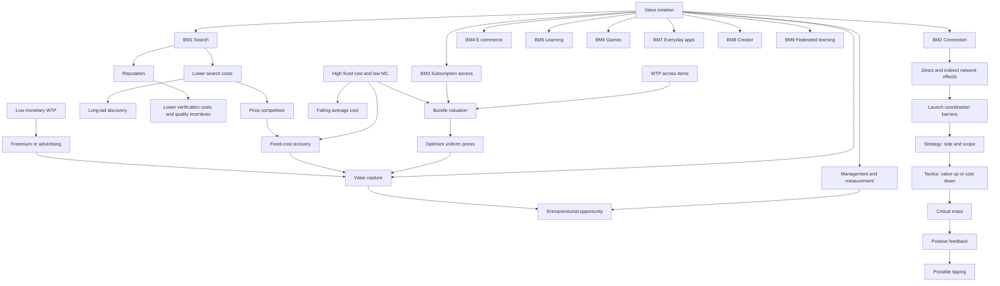

# Digital Business Models course knowledge graph

Updated 2026-10-20 from the three notes below. Conceptual synthesis only; no logistics, scheduling or recall records are graph nodes. Edges show course mechanisms or explicitly enriched connections explained in the notes, not universal empirical laws.

## Supporting Node List

| ID | Node / meaning | Evidence and study relevance |
|---|---|---|
| V | Value creation: participant benefit | [Overview](chapter-0-business-model-overview/chapter-0-business-model-overview.md), p. 14 lens |
| B1 | Search cost reduction | Overview BM1; economics pp. 17–19 |
| B2 | Connection, communication and reputation | Overview BM2; same/cross-side value in economics |
| B3 | Subscription access to content variety | Overview BM3; exercise Q12–15 |
| B4 | E-commerce: extend market reach | Overview BM4 |
| B5 | Learning access/enjoyment | Overview BM5 |
| B6 | Games: entertainment/competition | Overview BM6 |
| B7 | Everyday functional apps | Overview BM7 |
| B8 | Creator: inform/entertain/inspire | Overview BM8 |
| B9 | Federated learning: collaborative prediction with decentralized raw data | Overview BM9; technical definition enriched |
| M | Management principles and performance measurement | Overview's analytical lenses |
| C | Value capture: obtain revenue and cover costs | All notes; definition enriched |
| O | Entrepreneurial opportunity | Overview analytical lens |
| N | Direct/same-side and indirect/cross-side network effects | [Economics](chapter-i-digital-economics/chapter-i-digital-economics.md), pp. 2–5 |
| A | Chicken-and-egg and penguin barriers | Economics pp. 7–8; Q4 |
| ST | Launch strategy: side/scope/investment | Economics pp. 8–12; Q7–8 |
| T | Launch tactics: seeding, marquees, fringe benefits; subsidy, onboarding, knowledge transfer | Economics pp. 8, 13; Q5–6 |
| K | Critical mass: self-sustaining adoption threshold | Economics p. 3 |
| F | Positive adoption/value feedback | Economics p. 14 |
| TIP | Possible market tipping | Economics p. 15, explicitly conditional |
| S | Search cost: finding/comparing options | Economics pp. 17–18 |
| L | Long tail: aggregate niche demand | Economics p. 19 |
| R | Reputation / information asymmetry | Economics p. 21; Q9–11 |
| Q | Verification cost / quality incentives | Economics pp. 20–21; Q9–11 |
| D | Fixed cost and marginal cost | Economics pp. 22–24; Q1–3 |
| AC | Average cost / supply-side economies of scale | Economics p. 6; Q1–2 |
| P | Price competition / MC benchmark | Economics p. 22; Q3 |
| BC | Contribution and fixed-cost recovery | Enriched algebra from diagrams; Q3/Q12 |
| W | Item-level WTP | Economics pp. 25–28; Q13–15 |
| U | Bundle valuation and subscription packaging | Economics p. 25; Q12–15 |
| I | Uniform-price threshold optimization | [Exercise](exercise-01-digital-economics/exercise-01-digital-economics.md), Q15 derived solution |
| LW | Low monetary WTP | Economics pp. 26–28 |
| AD | Freemium / ad-funded access and attention/data exchange | Economics pp. 26, 29 |

## Supporting Edge List

| From | Relationship | To | Why It Matters |
|---|---|---|---|
| B1–B9 | are distinct mechanisms for | V | Classify by benefit, with possible overlap |
| V | tested through | M | Measure the promised outcome |
| M | informs | O | Identify a specific opportunity |
| V | can support | C | Value and profit remain distinct |
| C | constrains viability of | O | Revenue/cost model matters |
| B1 | reduces | S | Discovery/comparison benefit |
| S reduction | increases pressure through | P | Lower comparison frictions |
| S reduction | supports | L | Easier discovery of niche offers |
| B1 transaction matching | benefits from | R | Found offers still need credible trust |
| R | lowers | Q verification cost | Reliable signals and future incentives |
| B2 | may exhibit | N | Relevant participant value |
| N | creates dependence underlying | A | Others' participation affects adoption |
| A | addressed through | ST | Choose side/scope/investment |
| ST | guides deployment of | T | Strategy and intervention differ |
| T | helps attain | K | Value-increasing/cost-decreasing stimuli |
| K | supports | F | Adoption no longer needs continued incentives |
| F | may cause | TIP | No guarantee of complete concentration |
| D high fixed/low MC | makes possible | AC falling with volume | Supply-side economy, not a network effect |
| P | can make harder | BC | MC pricing may fail to cover fixed cost |
| D | requires | BC | Low incremental cost is not zero total cost |
| W | aggregates into | U | Totals may become more predictable |
| D low MC | supports economical | U | Additional bundle consumption is relatively cheap |
| B3 | packages access through | U | Catalogue and payment arrangement interact |
| U | provides demand inputs for | I | Count buyers at candidate prices |
| I | helps compare | C | Maximize each strategy before comparison |
| BC | is necessary for sustainable | C | Volume must earn positive contribution |
| LW | motivates | AD | Alternative payer/tier design |
| AD | is one approach to | C | Zero user price does not mean zero revenue/cost |

## Visual Recall Prompts

1. Rebuild the adoption loop and place one strategy and one tactic on it.
2. Draw separate search-cost and verification-cost branches and explain the difference.
3. Connect BM3 to low MC, WTP aggregation, optimal price and fixed-cost recovery.
4. Explain why average cost can fall without network effects and why critical mass does not prove profit.
5. Name a condition that breaks guaranteed tipping or perfect bundle-value averaging.
