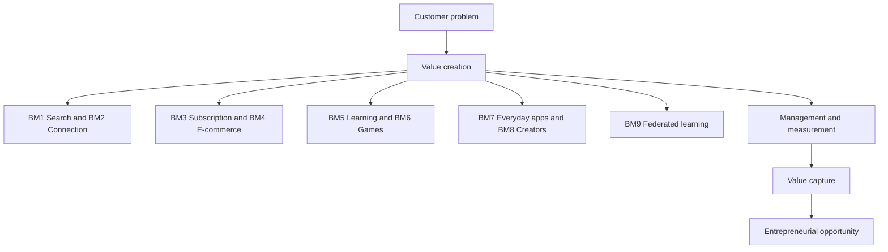

# Chapter 0: Digital Business Model Overview

Source: [Lecture - Chapter 0.pdf](../../raw/Lecture%20-%20Chapter%200.pdf), 23 PDF pages; conceptual focus pp. 4–14.
Course: Digital Business Models (MGTHN0206). Processed: 2026-10-20.
Wiki note: `digital-business-models/wiki/chapter-0-business-model-overview/chapter-0-business-model-overview.md`
Administration/exam rules: [logistics](../_course-logistics.md). Language: [CONTEXT.md](CONTEXT.md).

Provenance: **[source]** supplied deck; **[enrichment]** standard explanation/constructed example; **[derived]** calculation; **[inference]** learning emphasis. No recall completed.

## 80/20 Exam Summary

1. Explain what improves for the customer, then how the firm might earn revenue. Value creation and capture answer different questions. [source p. 14; distinction enriched]
2. Learn nine reusable innovation mechanisms by benefit, not by logo. They need not be exclusive company categories. [source pp. 6–9, 13; non-exclusivity enriched]
3. An app is a delivery interface, not proof of demand or profit. [source p. 7; explanation enriched]
4. Apply six lenses: value creation pattern, example, management principles, performance measurement, value capture and entrepreneurial opportunity. [source p. 14]

Priorities above are inferred; broad lecture/exercise coverage is confirmed in logistics, chapter weights are not.

## Core Concepts

### Nine patterns

Canonical meanings follow p. 13. Examples are pictured on p. 6, not current product audits.

| ID | Pattern | Value mechanism | Course illustration |
|---|---|---|---|
| BM1 | Search Costs Reduction | Less effort to find a suitable option/partner | Upwork, Amazon Marketplace |
| BM2 | Connection, Communication, and Reputation | Connect, communicate, express oneself, gain visibility/reputation | LinkedIn, Instagram |
| BM3 | Subscription Access to Content Variety | Broad catalogue for a flat fee rather than separate purchases | Spotify, Netflix, Kindle Unlimited |
| BM4 | Creating E-Commerce Markets | Add a digital channel, expanding reachable demand | AutoScout24, Vinted |
| BM5 | Increase enjoyment and access to learning | More accessible and engaging learning | Duolingo, Quizlet |
| BM6 | Mobile Games | Entertainment and competition | Pokémon GO, Candy Crush |
| BM7 | Everyday Problem-Solving App | Solve everyday problems and reduce inconvenience | Waze |
| BM8 | Content Creator | Inform, entertain and inspire | MrBeast / YouTube |
| BM9 | Collaborative AI through Federated Learning | Collaborate to improve prediction while keeping raw data decentralized | MELLODDY |

Other slides shorten BM5 to Learning Apps and BM8 to Digital Content. Preserve the fuller meanings. BM2 includes social reputation; transaction reputation develops in Chapter i.

**Value creation:** a benefit to a participant. **Value capture:** obtaining revenue and retaining profit after costs. **Revenue model:** who pays, for what, and on what basis. A benefit does not automatically generate cost-covering revenue. [p. 14 names creation/capture; definitions enriched]

**Performance measurement:** choose evidence near the promised outcome; installs alone do not show learning or completed transactions. [enrichment]

**Federated learning**, merely named here, coordinates training across data holders while raw training data stay with them; model updates/parameters may be exchanged. This alone does not guarantee that updates cannot reveal private information. No protocol or privacy theorem is taught here. [source p. 13; definition/boundary enriched]

## Mechanisms And Logic

For any case: identify customer/problem → select a benefit mechanism → state its assumptions → choose an outcome measure → propose payer/revenue basis → identify an improvement opportunity. This is an enriched application of p. 14, not a required answer rubric.

Example: a craft marketplace reduces comparison effort (BM1) and adds an online sales channel (BM4). It needs relevant listings and feasible trades. A transaction fee is a possible capture model, conditional on sufficient value and trade volume. The two patterns can coexist. [constructed example]

## Worked Calculations And Analogies

No numerical exercise or CLV/cost formula is supplied in this chapter. Quantitative work belongs to [Chapter i](../chapter-i-digital-economics/chapter-i-digital-economics.md) and [Exercise 1](../exercise-01-digital-economics/exercise-01-digital-economics.md).

**Worked classification [enrichment]:** A language app gives short exercises and feedback. Problem: learning access/engagement. Primary pattern: BM5. Mechanism: convenient repeated practice. Measure: delayed task performance; retention is supporting usage evidence. Possible capture: paid monthly access, a hypothesis rather than a fact about a named company. Trap: treating downloads as learning gains.

**Analogy:** app = shopfront; creation = useful service inside; capture = revenue/cost logic keeping it open.

## Diagrams, Tables, And Visuals

- pp. 4–5: company-value images motivate digital platforms. One is explicitly a 2022 market-cap snapshot; startup valuations are another dated illustration. They establish neither current rankings nor social welfare. Numeric valuations are not reproduced as current facts.
- pp. 6–7: company logos become app/browser symbols. Different benefit mechanisms can share technology; logos are examples, not exclusive categories.
- pp. 8–9: entrepreneurship/opportunity sketches include reputation/quality for search, social commerce/contextual media for connection, user understanding/unique content for subscriptions, and autonomy/agentic AI for e-commerce. These are prompts, not validated business proposals.
- p. 13: taxonomy; p. 14: analytical lenses. Administration and its visuals are recorded only in logistics.

## Visual Knowledge Map

## Subject Knowledge Graph

| Node | Meaning | Exam Relevance |
|---|---|---|
| Value creation | Participant benefit | Inferred case foundation |
| BM1 Search | Reduce search effort | Source taxonomy |
| BM2 Connection | Communication/visibility/reputation | Source taxonomy |
| BM3 Subscription | Flat-fee variety | Source taxonomy; exercised later |
| BM4 E-commerce | Expand reachable market | Source taxonomy |
| BM5 Learning | Access/enjoyment | Source taxonomy |
| BM6 Games | Entertainment/competition | Source taxonomy |
| BM7 Everyday apps | Functional convenience | Source taxonomy |
| BM8 Creator | Inform/entertain/inspire | Source taxonomy |
| BM9 Federated learning | Collaborative prediction | Source taxonomy |
| Measurement | Test promised outcomes | Source lens |
| Value capture | Obtain revenue/cover costs | Source lens |
| Opportunity | Improve useful, viable offering | Source lens |

| From | Relationship | To | Why It Matters |
|---|---|---|---|
| BM1–BM9 | offer mechanisms for | Value creation | Classify by benefit |
| Value creation | tested through | Measurement | Usage alone may be insufficient |
| Value creation | can support | Value capture | Benefit and profit differ |
| Measurement | informs | Opportunity | Diagnose a specific improvement |
| Value capture | constrains viability of | Opportunity | Cost coverage matters |

## Real Business Examples

Use the pattern-table examples as course illustrations. Explain the mechanism rather than reciting the logo. A creator and a subscription service can coexist in an ecosystem with different participants and benefits. Current prices/features/valuations were not independently checked.

## Exam Relevance

Confirmed scope: [logistics](../_course-logistics.md). **Inferred prompts:** classify an unfamiliar case, distinguish creation/capture, choose a benefit measure and propose an improvement with assumptions.

Traps: “uses AI” as a complete business model; subscription means profit; one company must fit exactly one category; decentralized data guarantees privacy; valuation equals welfare. Strong explanation: participant → benefit → mechanism → dependency → capture hypothesis.

## Retrieval Prompts

1. A marketplace saves comparison time and helps small sellers reach distant buyers. Which two patterns apply and why?
2. Distinguish creation/capture using a learning app.
3. Why might high adoption coexist with weak economics?
4. Reconstruct nine patterns by benefit.
5. What stays decentralized in BM9? Which privacy conclusion is too strong?

## Practice Tasks

1. For an everyday problem, select a pattern, outcome measure and possible payer.
2. Compare BM2 and BM8 on a creator platform: whose benefit does each describe?
3. State a failure condition for a search service and a subscription catalogue.

## Connections

First supplied chapter, no earlier course note. Continue to [economics](../chapter-i-digital-economics/chapter-i-digital-economics.md), then [Exercise 1](../exercise-01-digital-economics/exercise-01-digital-economics.md). Game Theory offers a later coordination connection, not a formal prerequisite established here.

## Uncertainties And Source Limits

Detailed management rules for individual patterns are not supplied yet. CLV, financing/pitching and analytics are goals rather than worked topics here. Dated graphics are motivation only. See [source audit](../../SOURCES.md).

## Weakness Flags

No user answers recorded; diagnostic prompts are not observed weaknesses.
