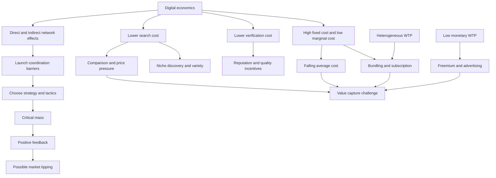

# Chapter i: Economics of Digital Goods and Markets

Source: [Lecture - Chapter i.pdf](../../raw/Lecture%20-%20Chapter%20i.pdf), all 30 PDF pages.
Course: Digital Business Models. Processed: 2026-10-20.
Wiki note: `digital-business-models/wiki/chapter-i-digital-economics/chapter-i-digital-economics.md`
Language: [CONTEXT.md](CONTEXT.md). Assessment: [logistics](../_course-logistics.md).

**Reference rule:** all page references below are PDF pages. Printed slide 14 is absent, so PDF pp. 14–30 carry printed labels 15–31. **[source]** = course; **[derived]** = calculation from supplied data; **[enrichment]** = standard clarification; **[inference]** = learning priority. No official answer key or recall results are implied.

## 80/20 Exam Summary

1. Network effects increase participant value with relevant participation; economies of scale reduce average production cost. Both can occur, but their mechanisms differ. [source pp. 2–6]
2. Platform launch must escape low participation → low value → difficult acquisition. Choose a launch strategy, then tactics that increase joining value or reduce joining cost until critical mass. [source pp. 7–13]
3. Digitization reduces search, verification and reproduction costs. Consumers may gain through lower prices, variety and trust while incumbent margins face pressure. These are mechanisms, not guarantees for every market. [source pp. 16–22; qualification enriched]
4. High fixed cost plus low marginal cost gives falling average cost. Pricing at marginal cost need not cover fixed cost. [source pp. 22–24; algebra enriched]
5. Low serving cost supports large content bundles. Diverse valuations can yield more predictable total WTP, enabling a single subscription price; it does not make every user value every item equally. [source p. 25; qualification enriched]
6. Low monetary WTP can motivate freemium or advertising. A zero user price still involves costs and may exchange attention/data for access. [source pp. 26–29]

Exercise 1 directly tests these mechanisms. They are high-priority practice by inference from supplied tasks, not a confirmed exam weighting.

## Core Concepts

### Network effects, critical mass and scale

| Concept | Mechanism | Source example / boundary |
|---|---|---|
| Direct network effect | More active users in the same group increase value to that group | Messaging contacts; relevant contacts matter, not global registrations alone (p. 2) |
| Indirect/cross-side network effect | More participation on one side increases value to another side | More relevant sellers attract buyers; more buyers attract sellers (p. 4) |
| Critical mass | Network large/useful enough for further adoption without continued external incentives | Threshold varies with connectivity and competing services (p. 3) |
| Economies of scale | Larger volume reduces per-unit/average cost | Supply-side mechanism, not extra user value from connections (p. 6) |
| Chicken-and-egg problem | Each side waits for participation on the other side | Two-sided launch (p. 7; Exercise 1 Q4) |
| Penguin problem | Individual users wait for others to adopt to avoid being stranded | Named in p. 8; distinction explicit in Exercise 1 Q4 |
| Market tipping | Positive feedback shifts adoption toward a leading network | Possible, explicitly not guaranteed (p. 15) |

LinkedIn illustrates both same-group professional connection and cross-group worker/company value (p. 5). A new seller need not improve value for incumbent sellers: the cross-side effect is the benefit to buyers. Extra competition within a side is a separate consideration. [enrichment]

### Launch strategies versus tactics

**Strategy** chooses initial market side(s), geographic/community scope and investment scale. **Tactic** changes joining value, cost or effort. [source pp. 8–13; synthesis]

| Initial focus | Small-scale strategy | Large-scale strategy | Value-increasing tactics in p. 8 | Cost-decreasing tactics in p. 8 |
|---|---|---|---|---|
| Consumer side | Limited consumer-side opening | Extensive consumer-side opening | Policy distinction (named, not defined further) | Subsidizing, onboarding |
| Seller side | Limited seller-side opening | Extensive seller-side opening | Fringe benefits | Subsidizing, onboarding |
| Both sides | Start small | Hell-bent strategy | Seeding, marquees, fringe benefits | Subsidizing, onboarding, knowledge transfer |

**Limited consumer-side opening:** restrict access using invitations/eligibility to build an engaged network before expanding. Course examples: LinkedIn, Pinterest. **Limited seller-side opening:** give selected suppliers useful tools first, then activate the consumer marketplace. Examples: OpenTable, Mindbody (p. 12).

**Start small:** concentrate both sides in a useful niche, local area or community; expand after transactions and feedback work there. A small headcount without relevance/density is not enough. Examples in p. 12: local ride-hailing and accommodation around an event. **Hell-bent:** large coordinated investment to activate both sides quickly; Exercise 1 Q8 supplies the balanced cleaning-market example. It needs funding and matching supply/demand, not just broad advertising.

**Piggybacking:** access an existing audience through another platform. p. 11 illustrates Airbnb/Craigslist cross-posting. This describes the course's historical illustration, without independently validating its details.

| Tactic | Mechanism | Course classification | Example as presented in p. 13 |
|---|---|---|---|
| Onboarding | Reduce setup effort and complexity | Cost-decreasing | Help hosts improve listings/photography |
| Subsidizing | Reduce financial cost of joining/participating | Cost-decreasing | Signup/referral payments |
| Fringe benefits | Useful functionality even before a network exists | Value-increasing | Photo-editing tools |
| Marquee users | Attract influential participants whose presence makes joining attractive | Value-increasing | Prominent content creators |
| Knowledge transfer | Training/best practices reduce learning effort and improve effective use | Cost-decreasing in p. 8 and Exercise 1 Q6 | Seller education/resources |
| Seeding | Platform supplies early content/activity before contributions arrive | Value-increasing | Initial posts/content |

Real tactics can affect both value and cost. For course classification use the table, then explain the mechanism. The p. 13 seeding example mentions multiple accounts; it is historical illustration, not a recommendation to misrepresent activity.

### Costs, competition, quality and willingness to pay

- **Search cost:** time/effort/money finding and comparing products, prices or partners. Lower cost can increase price transparency/competition and discovery of niche products (pp. 17–19).
- **Verification cost:** effort assessing reliability, trustworthiness and quality. Lower verification cost improves quality transparency and incentives to invest in quality; unknown reliable sellers can compete with established trust signals (pp. 20–21; Exercise Q9).
- **Marginal cost (MC):** cost of one additional unit; **average total cost (ATC):** all cost divided by units. Low MC is compatible with high ATC at low volume (pp. 22–24; algebra enriched).
- **Reputation system:** ratings/history/reviews reduce information asymmetry. The course requires signals that distinguish reliable sellers, reward trustworthy behavior and discourage untrustworthy participation (p. 21). A rating average alone does not ensure credible signals.
- **WTP:** maximum monetary price a consumer will pay for a specified offer (p. 27). It depends on the consumer and offer; quality does not fix a unique WTP.
- **Experience good:** quality is uncertain until consumption/use (p. 28; standard definition enriched).
- **Bundling:** offer several items together. **Subscription:** charge for access over a time period. They often coexist, but one is packaging and the other a payment/access arrangement. [source p. 25; distinction enriched]
- **Freemium:** a free basic tier and paid upgrades; **advertising model:** advertisers fund access to audience attention. Mentioned but not developed as detailed models here (p. 26; definitions enriched).

## Mechanisms And Logic

### Adoption feedback

Before critical mass: few relevant users → low expected benefit → reluctance to join → few users. A dense niche improves the chance of useful interactions; standalone tools add value before interactions exist. Subsidies/onboarding lower the joining hurdle. After enough useful participation, more adoption → greater value → more adoption (pp. 3, 7–9, 14).

This assumes relevant active users and a service that facilitates valuable interaction. Critical mass is not a universal number and does not itself prove profit: fixed costs and later monetization remain separate tests. The tipping graph is a possible path, not a forecast (p. 15).

### Lower frictions and producer pressure

1. Search cost ↓ → easier comparison → price competition ↑ → prices/margins under pressure; independently, easier discovery → niche demand ↑ (p. 18).
2. Verification cost ↓ → quality transparency ↑ → pressure to maintain quality ↑ → margins can fall (p. 20). Exercise Q9 adds erosion of the premium attached to established trusted brands/licenses when entrants can credibly signal quality.
3. MC ↓ with strong price competition → price tends toward MC (p. 22). The slide's `P = MC = 0` is an idealized zero-MC benchmark. Differentiation, market power and positive serving costs can change actual prices. [qualification enriched]

Do not confuse lower search/verification effort for buyers with lower production MC for sellers. Nor does margin pressure prove lower total producer profit in every case: quantity, costs and market power may change. [enrichment]

### Subscription and preference aggregation

Low MC makes serving additional catalogue items relatively cheap under the model. Consumers value different items; when those differences offset, total bundle WTP is more similar/predictable than item-level valuations. A common price can therefore sell broadly and recover fixed costs (p. 25).

This relies on sufficient paid demand and content/serving costs compatible with the price. Perfectly correlated preferences need not average out; extra catalogue size alone does not guarantee profit. Fixed annual licensing is an assumption of Exercise Q12, not a universal real-streaming contract. [enrichment]

### Low WTP and the zero-price offer

p. 28 lists uncertain quality, free/cheap substitutes, accustomed free access and the attractiveness of zero price. p. 29 contrasts €1.50/month with no ads/minimal service data use against €0 with ads and targeting/partner data use. The user contributes attention/data while advertisers pay money. This is a choice illustration, not measured evidence that all consumers value privacy little. [source; evidence boundary enriched]

## Worked Calculations And Analogies

### 1. Cost structure and average cost

**Method [enrichment]:** with fixed cost `F` (€), quantity `q` (downloads) and constant marginal cost `c` (€/download), `TC(q)=F+cq`, `MC=c`, `ATC=F/q+c` for `q>0`. Fixed cost is spread, not eliminated. Revenue `R=pq`; profit `π=(p-c)q-F` for the same period.

**Exercise Q2 inputs [source]:** `F=€200,000`, `c=€0.10/download`, `q=500,000 downloads`.

1. Variable cost `=0.10×500,000=€50,000`.
2. Total cost `=200,000+50,000=€250,000`.
3. MC `=€0.10/download`.
4. ATC `=250,000/500,000=€0.50/download` (`€0.40` fixed-cost allocation + `€0.10` variable cost).

Managerial interpretation: a price of €0.10 covers incremental service cost, not total cost. Analogy: producing the master textbook costs money even if distributing another file is cheap. Trap: treating `F/q` as ATC and omitting `c`.

### 2. Incremental MC and pricing at MC

**Exercise Q3 inputs:** `TC(20,000)=€130,000`, `TC(25,000)=€135,000`.

`ΔTC=€5,000`; `Δq=5,000 users`; observed incremental cost `ΔTC/Δq=€1/user` over this interval. Under the exercise's constant-MC interpretation, price every user at €1: `R=25,000×1=€25,000`; `π=25,000−135,000=−€110,000`. ATC is `135,000/25,000=€5.40/user`, not MC. A local linear fit gives `F=135,000−1×25,000=€110,000`; this is a derived model, not proof that MC is constant outside the interval.

Interpretation: charging all users at MC fails to recover the fixed component. Trap: dividing total cost by current users and calling it MC.

### 3. Break-even and the diagrams

Set `π=0`: `(p-c)q=F`, so `q_BE=F/(p-c)` if `p>c`, with integer quantity rounded up. If `F>0` and `p≤c`, no finite volume covers fixed cost in this simple model. [enrichment deriving p. 24 intuition]

In p. 23's stylized chart, digital total cost is 5 model cost units at every quantity; physical total cost equals quantity. Equating `5=q` gives a **cost crossover at 5 units**. At 2 units digital cost 5 exceeds physical cost 2; at 8 units digital cost 5 is below physical cost 8. These are dimensionless diagram values, not measured euros. The crossing is not a break-even point because no revenue curve appears there.

p. 24 adds revenue: break-even is where total revenue crosses total cost. The digital panel has a horizontal fixed-cost line; the physical panel has a positive cost slope. No calibrated numeric axes are supplied, so do not invent numerical break-even volumes from that panel. Small positive contribution margin needs large volume; zero contribution margin cannot recover fixed cost.

### 4. Bundling

Exercise Q15 has Pop WTP `(10,2,8,4)` and Rock `(2,10,4,8)` euros. Each song has sorted values `2,4,8,10`. Uniform price candidates give revenues: `2×4=8`, `4×3=12`, `8×2=16`, `10×1=10` euros. Price €8 maximizes each song's revenue; separate total `16+16=€32`. Each consumer's bundle WTP is €12, so price €12 sells four bundles: `12×4=€48`. Gain `48−32=€16`, or `16/32=50%` of separate revenue. MC is zero; these are profits before any unspecified common fixed cost. All steps/assumptions: [Exercise 1](../exercise-01-digital-economics/exercise-01-digital-economics.md#q15-complete-pricing-solution).

Analogy: customers favor different tracks but can value the whole album similarly. Trap: saying their individual preferences changed or that every bundle always produces identical WTP.

## Diagrams, Tables, And Visuals

| PDF pages | Read the visual as | Avoid |
|---|---|---|
| 2–5 | Relevant contacts, same-side/cross-side value, critical-mass adoption curve | A universal headcount threshold |
| 6 | Demand-side value versus supply-side cost table | Treating compounding as endless exponential growth |
| 7–9 | Bad launch loop; strategy/tactic/traction matrix; interventions break the loop | Calling a sign-up bonus a launch scope |
| 10–13 | Dense launch, piggybacking, strategy/tactic examples | Memorizing names without mechanisms |
| 14–15 | Positive feedback and illustrative tipping shares | Guaranteed monopoly or measured market shares |
| 16–18 | Welfare question; three cost types; separate transparency and discovery branches | Equating consumer gains with incumbent gains |
| 19 | Ranked-product long tail: many small-selling items collectively matter; shaded sales beyond rank 100,000 | Claiming every niche item sells much, or inferring precise shares |
| 20–22 | Quality/trust incentives and competitive zero-MC benchmark | Universal zero price |
| 23–24 | Cost intercept/slope, then total revenue versus cost | Cost crossover = business break-even |
| 25–28 | Bundle aggregation, WTP and four reasons for low WTP | WTP irrelevant because MC is low |
| 29–30 | Paid-versus-ad/data-funded offer and stylized traditional/digital summary | Zero monetary price means no economic exchange; universal margin rankings |

## Visual Knowledge Map

## Subject Knowledge Graph

| Node | Meaning | Exam Relevance |
|---|---|---|
| Direct network effect | Same-side participation raises value | Exercise Q4 reasoning |
| Indirect network effect | Cross-side participation raises value | Q4, Q7–8 |
| Economies of scale | Volume lowers average cost | Q1–2, Q5 distinction |
| Critical mass | Self-sustaining adoption threshold | Q4–8 |
| Launch barriers | Chicken-and-egg and penguin waiting | Q4 |
| Launch strategy | Initial side/scope/investment | Q7–8 |
| Launch tactics | Value-increasing or cost-decreasing interventions | Q5–6 |
| Tipping | Possible concentration via feedback | Lecture mechanism |
| Search costs / long tail | Finding offers / discovery of niche demand | Q10 context |
| Verification / reputation | Trust assessment / credible history | Q9–11 |
| Fixed and marginal costs | Creation cost and incremental service cost | Q1–3, Q12 |
| Average cost | Total cost per unit | Q2–3 |
| Price competition | Pressure on price relative to MC | Q3 |
| WTP | Consumer maximum monetary price | Q13–15 |
| Bundling / subscription | Packaging / recurring access price | Q12–15 |
| Freemium / advertising | Alternative capture with low user WTP | Lecture mechanism |

| From | Relationship | To | Why It Matters |
|---|---|---|---|
| Direct/indirect effects | create | Launch barriers | Value depends on others |
| Launch strategy | focuses | Launch tactics | Decide where/whom before interventions |
| Launch tactics | help reach | Critical mass | Raise value or reduce joining costs |
| Critical mass | enables feedback that may lead to | Tipping | Possibility, not certainty |
| Search cost reduction | supports | Long-tail discovery | Variety as well as price competition |
| Reputation | reduces | Verification costs | Credible trust supports entry/trade |
| High fixed/low MC | yields falling | Average cost | Fixed costs spread with volume |
| Price competition | can prevent recovery of | Fixed cost | MC price can produce losses |
| Low MC and offsetting WTP | support | Bundling/subscription | Cheap serving and more predictable value |
| Low user WTP | motivates | Freemium/advertising | Identify the actual payer |

## Real Business Examples

Source illustrations: LinkedIn for both network-effect types; OpenTable/Mindbody for supplier tools; Airbnb/Craigslist for piggybacking; Instagram for standalone functionality; Twitch for marquees; Etsy for knowledge transfer; Reddit for seeding. Use them as illustrations of the stated mechanism, not independent historical/current company facts. For unfamiliar cases, a local trainer marketplace is enough to explain density and matching without relying on brand knowledge.

## Exam Relevance

All supplied lecture/exercise content is in confirmed coverage; exact weights and MC selection/scoring rules remain unknown. **Inferred high-yield tasks:** classify the effect and relevant side; identify launch strategy/tactic; distinguish MC/ATC and calculate loss; explain reputation/entry; optimize separate versus bundle prices.

Answer a case with mechanism → condition → outcome → limitation. For MC practice, explain why the best alternative fits and why each plausible distractor fails. Do not import an unspecified “all correct answers” exam convention.

## Retrieval Prompts

1. Can user value rise even if MC stays unchanged? Can ATC fall with no network effect?
2. Explain chicken-and-egg versus penguin using a trainer platform.
3. Classify seeding, onboarding, subsidies, marquees, fringe benefits and knowledge transfer.
4. Why might one district beat a nationwide launch for a resource-constrained marketplace?
5. Explain lower search cost's two branches: prices and niche discovery.
6. What three properties should a reputation signal satisfy?
7. Reconstruct MC/ATC from `TC=F+cq`, including units.
8. Why can `p=MC` cause losses? Under what condition does more volume recover fixed cost?
9. Why can bundling narrow total-valuation differences without changing tastes?
10. What does a user supply in an ad-funded service, and who pays money?

## Practice Tasks

1. Solve [Exercise 1 Q1–6](../exercise-01-digital-economics/exercise-01-digital-economics.md) before opening its solutions, then Q7–15.
2. Draw the low-adoption and self-sustaining loops; mark one value and one cost intervention.
3. Recompute Q2 at 250,000 downloads and explain why MC stays €0.10 but ATC changes.
4. Change Q15 so all customers strongly prefer the same song. Explain why bundle-total averaging need not persist.

## Connections

Prior note: [Chapter 0](../chapter-0-business-model-overview/chapter-0-business-model-overview.md). Its BM1, BM2 and BM3 gain explicit search/network/bundling mechanisms here. Next: [Exercise 1](../exercise-01-digital-economics/exercise-01-digital-economics.md). Optional after first passes: compare adoption coordination with [Game Theory strategic games](../../../game-theory/wiki/session-01-strategic-games/session-01-strategic-games.md), without assuming a particular payoff matrix or equilibrium model is taught here.

## Uncertainties And Source Limits

- p. 10 calls early Facebook “Facemash.” That naming appears questionable; preserve only the dense-community teaching mechanism here. No corrected history is asserted without verification.
- “Policy distinction” in p. 8 is not defined elsewhere in the supplied material; do not invent a lecturer-specific definition.
- p. 6's growth/industry table and p. 30's traditional/digital margin comparison are stylized tendencies, not universal laws.
- p. 29's title about privacy has no sample or empirical test on that slide. Treat it as a discussion proposition.
- No CLV formula, estimated critical-mass value, price-demand curve or calibrated forecast is supplied. Algebra above is labeled enrichment or exercise-derived.
- See [source audit](../../SOURCES.md) for numbering and export limitations.

## Weakness Flags

No user answers recorded. Cost distinctions, tactic labels and bundle-price optimization are candidate diagnostics, not observed errors.
