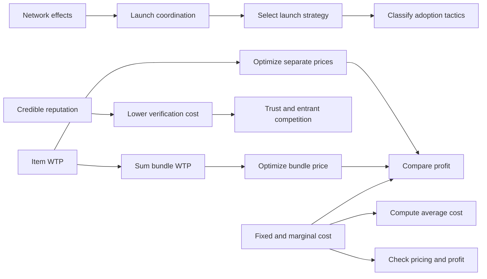

# Exercise 1: Economics of Digital Goods and Markets

Source: [Exercise 1.pdf](../../raw/Exercise%201.pdf), all 6 pages, Q1–15.
Course: Digital Business Models. Processed: 2026-10-20.
Wiki note: `digital-business-models/wiki/exercise-01-digital-economics/exercise-01-digital-economics.md`
Prerequisite: [Chapter i economics](../chapter-i-digital-economics/chapter-i-digital-economics.md). Language: [CONTEXT.md](CONTEXT.md).

**Solution status:** every answer below is **coach-derived from the supplied questions and lecture**, not an official answer key. Question numbers, inputs and assumptions are source facts; answer explanations are derived. No user answer, score or completed retrieval session is recorded. Attempt the original sheet before opening the solution section.

## 80/20 Exam Summary

- Q1–3 distinguish fixed cost, MC, ATC and losses at MC pricing.
- Q4–8 distinguish launch coordination barriers, strategy and tactic; density and balanced participation matter.
- Q9–11 link credible reputation to verification, entry and trustworthy behavior.
- Q12–15 link low MC, sufficient paid scale, bundle WTP and optimal prices.

The course confirms exercises are covered by the exam. These tasks are evidence of supplied practice emphasis, not a promise of identical exam items or scoring rules.

## Core Concepts

| Distinction | Decision rule |
|---|---|
| MC versus ATC | MC measures added cost per added unit; ATC divides total cost by all units |
| Revenue versus profit | `R=pq`; `π=R−TC` |
| Network effect versus scale economy | Added participant value versus reduced average cost |
| Chicken-and-egg versus penguin | Waiting for the other side versus individual reluctance to adopt first |
| Strategy versus tactic | Market scope/side/investment versus adoption intervention |
| Seeding/marquees/fringe benefits | Increase joining value in course classification |
| Subsidies/onboarding/knowledge transfer | Reduce financial/setup/learning cost in course classification |
| Search versus verification | Find/compare offers versus establish reliability/trust |
| Bundle versus individual WTP | Total valuation can converge while item valuations remain different |

## Mechanisms And Logic

For each question identify the requested outcome, then the mechanism and assumptions. Avoid choosing a familiar phrase that answers a different question. Q7 asks for **start small**; Q8 explicitly asks for **hell-bent**, so their recommended scopes differ with the stated resources/strategy. Q13 asks why one price works across heterogeneous tastes, so low MC alone is incomplete. Q15 requires optimizing each separate price before comparing the bundle.

## Worked Calculations And Analogies

### Derived answer index

Use after an attempt. Letters refer to this supplied version only.

| Q | PDF p. | Derived answer | Decisive mechanism |
|---:|---:|:---:|---|
| 1 | 1 | d | High fixed/low marginal cost permits falling ATC |
| 2 | 1 | c | MC €0.10; ATC €0.50/download |
| 3 | 1 | a | Incremental MC €1; loss €110,000 |
| 4 | 2 | b | Other-side waiting versus individual first-adopter waiting |
| 5 | 2 | c | Credit and workshops reduce joining costs |
| 6 | 2 | a | Seeding/marquees/fringe benefits versus onboarding/knowledge transfer |
| 7 | 3 | c | Recruit both sides in one district |
| 8 | 3 | d | Coordinated strong incentives/marketing on both sides |
| 9 | 3 | b | Credible entrants erode incumbents' trust premium |
| 10 | 4 | b | Credible reviews, verification and fraud detection |
| 11 | 4 | c | Consistent quality, accurate descriptions, professional responses |
| 12 | 4 | d | Low marginal serving cost plus scale to recover fixed licensing |
| 13 | 5 | c | Individual valuation differences offset in total bundle WTP |
| 14 | 5 | d | Capture, access and recurring revenue mechanisms all apply |
| 15 | 6 | b | Separate €32; bundle €48 under stated assumptions |

### Q1: Cost structures

**d** follows from `ATC=F/q+c`: high `F` and small `c` can produce declining ATC as output grows. **a** reverses fixed/marginal costs and claims constant physical total cost. **b** ignores high upfront costs at low output. **c** incorrectly makes digital ATC constant and physical ATC universally declining. Digital does not mean cheap to create. Analogy: costly master file, inexpensive copies.

### Q2: MC and ATC with units

Given `TC(q)=€200,000+(€0.10/download)q`, `q=500,000 downloads`.

1. Variable cost: `€0.10/download × 500,000 downloads = €50,000`.
2. Total cost: `€200,000+€50,000=€250,000`.
3. MC: slope `=€0.10/download`.
4. ATC: `€250,000/500,000 downloads=€0.50/download`.

Choose **c**. **a** omits variable cost from ATC (`F/q=€0.40`). **b** swaps MC/ATC. **d** mistakes average fixed cost for MC. Interpretation: selling at €0.10 covers another download but does not recover creation cost.

### Q3: Incremental cost and loss

Given total costs €130,000 at 20,000 users and €135,000 at 25,000 users:

`ΔTC=135,000−130,000=€5,000`; `Δq=25,000−20,000=5,000 users`; `ΔTC/Δq=€1/user`.

At a uniform price of €1/user, `R=€1×25,000=€25,000`; `π=25,000−135,000=−€110,000`: **a**. The observed slope is incremental average cost over the interval, interpreted as MC for this exercise; it does not prove a constant global derivative.

**b** ignores cost recovery; **c** uses ATC `135,000/25,000=€5.40` as MC; **d** divides the added cost by all final users (`5,000/25,000=€0.20`). Its loss figure does not follow from its own stated price either. Under a local linear model `F=€110,000`; pricing at `c` leaves exactly this fixed-cost loss.

### Q4: Two adoption barriers

**b** correctly distinguishes each side awaiting the other (chicken-and-egg) from a user avoiding first-adopter isolation (penguin). **a** swaps the concepts. **c** substitutes development costs for coordination. **d** substitutes high pricing and participation on multiple platforms. Do not reduce all launch problems to subsidies.

### Q5: Credit and workshops

First 500 sellers receive €50 credit and onboarding help: **c**, cost-decreasing subsidy/onboarding intended to support adoption toward critical mass. Credit reduces monetary entry cost; workshops reduce effort/uncertainty. **a** calls this seeding/marquees and claims permanent standalone value; **b** invokes a different label; **d** substitutes sellers' production scale for platform adoption.

### Q6: Tactic classification

**a**: seeding supplies initial activity, marquees attract participants, fringe benefits provide independent utility → value-increasing. Onboarding and knowledge transfer reduce setup/learning burden → cost-decreasing in the course framework. **b** reverses the grouping; **c** puts knowledge transfer with value and fringe benefits with cost; **d** puts onboarding with value and seeding with cost. A real action may have multiple effects; this question tests the lecturer's classification.

### Q7: Start small

**c** recruits local trainers and nearby customers within one district: concentrate useful supply/demand before expansion. **a** spends widely nationwide. **b** builds scattered supply before matching demand. **d** offers a small supplier group tools but opens demand nationwide; that is closer to a supplier-first/standalone-tools approach, not the targeted dense two-sided launch asked for. A small group by itself is not the key; relevant interaction density is.

### Q8: Hell-bent

**d** uses coordinated marketing, customer discounts, provider bonuses and referrals to build both sides rapidly. **a** is broad, but describes lighter provider participation support and lacks the same coordinated incentives; **b** relies on sellers arriving organically; **c** recruits sellers heavily while attracting customers gradually. **d** best matches the expressly funded rapid two-sided strategy. This does not prove hell-bent is optimal for a cash-constrained startup.

### Q9: Verification and margins

**b**: trustworthy unknown entrants can show quality through credible reputation. Incumbents' premium for being familiar/licensed is eroded and entrants compete on price. **a** is production automation, **c** reverses the mechanism by increasing dependence on established brands, **d** is tracking/price discrimination rather than verification of unknown providers. This is a mechanism in the scenario, not a new empirical claim about current industry margins.

### Q10: Platform reputation design

**b** improves credibility through verified-purchase information, identity verification and fraudulent-rating detection. **a** allows selective deletion and undermines signals; **c** excludes entrants and merely assumes reviews unnecessary; **d** treats fees as proof of quality without a mechanism. Verification measures improve reliability; none alone guarantees truth or zero fraud.

### Q11: Seller behavior

**c** combines consistent quality, accurate descriptions and professional response to criticism. **a** prioritizes review count while neglecting complaints; **b** assumes low prices replace trust; **d** prioritizes short-term ratings over durable reliability. Link current behavior to future visible reputation rather than optimizing only a displayed average.

### Q12: Flat-fee access and fixed licensing

**d**: near-zero extra stream cost makes unlimited usage relatively inexpensive under the stated fixed annual licensing assumption; subscription revenue across enough subscribers recovers fixed cost. **a** assumes costly plays, **b** wrongly says listening uses up a song, **c** confuses near-zero MC with zero fixed cost.

**Period check [enrichment]:** if annual fixed licensing/other fixed cost is `F_year`, €10/month yields `12×€10=€120/subscriber-year` for a subscriber retained for 12 paying months. Ignoring all variable/other costs, break-even needs `N≥F_year/120`, rounded up. No numeric `F_year` is supplied, so no numeric subscriber threshold can be claimed. Churn, actual contracts and serving costs can change this simple model.

### Q13: Why one bundle price can work

**c** aggregates heterogeneous item valuations so totals become more predictable. **a** incorrectly changes tastes for individual songs; **b** makes WTP irrelevant; **d** says every subscriber values every song equally and all value is captured. Equal bundle totals in Q15 are a deliberately strong example, not a universal property of large bundles.

### Q14: Platform value from subscription access

**d**, because in the question's setting all three stated mechanisms apply: **a** better capture of aggregate WTP; **b** flat-rate catalogue access instead of item transactions; **c** recurring revenue less dependent on individual purchases. They are complementary explanations. Recurring does not mean guaranteed: retention and collection matter. “All of the above” here establishes no general exam selection rule.

### Q15: Complete pricing solution

**Decision:** maximize revenue under separate uniform song prices versus a pure bundle. With specified MC zero and no fixed cost amount, compare profit before any common unspecified fixed cost. Price discrimination between consumers is not allowed. The platform may set a different uniform price for each song. Customers buy at `WTP≥price`.

**Source inputs, euros per song/bundle:**

| Content | A | B | C | D |
|---|---:|---:|---:|---:|
| Pop | 10 | 2 | 8 | 4 |
| Rock | 2 | 10 | 4 | 8 |
| Bundle total | 12 | 12 | 12 | 12 |

For one song, `R(p)=p×number of consumers with WTP≥p`. Between adjacent WTP thresholds quantity is constant, so increasing price to the next included WTP raises revenue. It is sufficient to check the positive WTP thresholds plus the zero-sales case.

| Candidate uniform price | Buyers per song | Revenue Pop | Revenue Rock |
|---:|---:|---:|---:|
| €2 | 4 | €8 | €8 |
| €4 | 3 | €12 | €12 |
| €8 | 2 | **€16** | **€16** |
| €10 | 1 | €10 | €10 |
| Above €10 | 0 | €0 | €0 |

Separate optimum: `p_Pop=p_Rock=€8`. Pop buyers A/C, Rock buyers B/D. Total `R_sep=€16+€16=€32`. At zero MC, corresponding variable-cost profit is €32.

Bundle: all four totals equal €12. At `p_B≤€12`, four buy; revenue rises with price up to `€12×4=€48`. Above €12 nobody buys. Thus `p_B*=€12`, `R_B=€48`, corresponding profit €48. At equality consumers buy by explicit assumption. If an unchanged fixed cost `F` applied, profits would be `32−F` and `48−F`; the ranking/gain stays the same.

Gain `€48−€32=€16`, a `€16/€32=50%` increase over separate sales. **b** is correct. **a** gives the wrong separate optimum and falsely says tastes become equal; **c** mistakes unchanged total WTP for unchanged extractable revenue; **d** invents a compulsory bundle discount and wrong totals.

**Interpretation:** preferences remain different: A values Pop far more than Rock, B the reverse. The sums happen to match. A single bundle price captures more of those totals than separate uniform prices. Total willingness to pay is not automatically collectible revenue under every pricing constraint.

## Diagrams, Tables, And Visuals

The sheet has text questions on pp. 1–5 and the valuation table on p. 6. Q1–6 form concept/application practice; Q7–15 emphasize strategy evaluation/design and pricing. The Q15 table shows opposing song preferences but identical row-wise consumer totals. The graph below connects the tasks; it is an enriched synthesis rather than an additional source figure.

## Visual Knowledge Map

## Subject Knowledge Graph

| Node | Meaning | Exam Relevance |
|---|---|---|
| MC/ATC | Added-unit versus all-unit cost | Q1–3 |
| Contribution/fixed-cost recovery | `(p−c)q` must cover `F` | Q3, Q12 |
| Launch coordination | Participation depends on others | Q4 |
| Strategy/tactics | Scope and adoption interventions | Q5–8 |
| Reputation | Credible trust/behavior signal | Q9–11 |
| Bundle WTP | Sum of item valuations | Q13–15 |
| Uniform price optimization | Check thresholds and quantity | Q15 |
| Subscription | Recurring flat-fee access | Q12–14 |

| From | Relationship | To | Why It Matters |
|---|---|---|---|
| MC/ATC distinction | informs | Fixed-cost recovery | MC pricing can lose money |
| Launch coordination | motivates | Strategy/tactics | Choose interventions matching the barrier |
| Reputation | reduces | Verification costs | Enables trust and entrant competition |
| Low MC | supports economical | Subscription | Fixed costs still require recovery |
| Item WTP | aggregates into | Bundle WTP | Total valuations can converge |
| Uniform price optimization | compares revenue from | Separate and bundle sales | Optimize both, then compare |

## Real Business Examples

The sheet uses a textbook platform, cloud tool, fitness/cleaning marketplaces, accommodation/transportation entrants, transaction platforms and music content. Treat their numerical/scenario assumptions as exercise inputs. In particular, fixed licensing and €10/month in Q12 are hypothetical, not current commercial terms of a named service.

## Exam Relevance

Confirmed: lecture and exercise materials are included. Inferred high-yield practice: explain each choice without letters, eliminate the closest distractor, and redo Q2/Q3/Q15 with changed inputs. Traps: MC=ATC; low MC=no fixed cost; sign-up credit=seeding; nationwide spending=start small; review count=credibility; bundle preference=equal individual preferences; zero MC=irrelevant WTP.

## Retrieval Prompts

1. Derive Q2's MC and ATC without seeing the answer choices.
2. Calculate Q3's loss and explain why volume alone cannot help at `p=MC`.
3. Give separate chicken-and-egg and penguin mechanisms.
4. Explain Q7 versus Q8 without saying one strategy is always best.
5. Why does reliable reputation reduce an incumbent's trust premium?
6. Reconstruct all Q15 candidate revenues and check who buys at equality.
7. What would change if licensing were paid per stream rather than fixed annually?

## Practice Tasks

1. Closed book, solve Q1–6; justify each answer before checking the index.
2. Solve Q7–14 by naming participant, barrier, intervention and outcome.
3. Solve Q15 on a blank page. Then change D's Pop WTP from €4 to €6; re-optimize each price and the bundle rather than assuming the same best price.
4. Explain which assumptions would make the derived subscription break-even formula misleading.

## Connections

Prior concepts: [Chapter 0](../chapter-0-business-model-overview/chapter-0-business-model-overview.md) and [Chapter i](../chapter-i-digital-economics/chapter-i-digital-economics.md). Q12–15 apply BM3; Q9–11 connect BM1 transaction discovery with credible verification. Optional cross-course link after first passes: [Game Theory](../../../game-theory/wiki/session-01-strategic-games/session-01-strategic-games.md) for coordination and incentives; no payoff matrix is specified by this exercise.

## Uncertainties And Source Limits

No official solutions, marking scheme or formula sheet supplied. Derived answers should be reconciled if an official key arrives. Q3 identifies an interval cost slope, not all local/global derivatives. Q12 fixes licensing by assumption. Q15 gives no fixed cost, real contract structure or repeated subscription horizon. Do not broaden these results beyond the stated model.

## Weakness Flags

No user attempts or errors recorded. The answer index is reference material, not a completed session or performance result.
