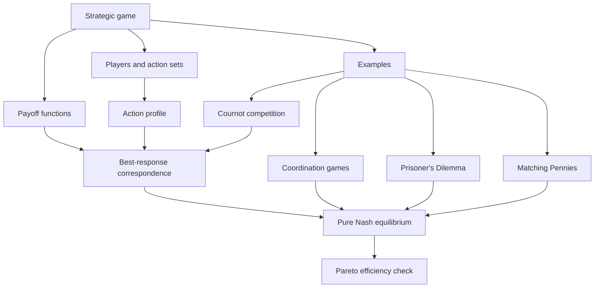

# Game Theory course knowledge graph

Source currently processed: Session 1, `game-theory/raw/GT Slides 01.pdf` (2026-10-09). This graph contains conceptual content only.

## Course-level Mermaid graph

## Node list

| Node | Meaning | Study use |
|---|---|---|
| Strategic game | Players, action sets, payoff functions | Specify the model before solving |
| Action profile | One action per player | Candidate outcome |
| Best-response correspondence | All payoff-maximizing actions against opponents' fixed actions | Find equilibria and ties |
| Pure Nash equilibrium | Every chosen action is a best response | Check unilateral deviations |
| Pareto efficiency | No feasible Pareto improvement | Assess welfare separately from equilibrium |
| Cournot competition | Two firms choose quantities simultaneously | Derive continuous best responses |

## Edge list

| From | Relationship | To | Why it matters |
|---|---|---|---|
| Strategic game | defines | Players and action sets | Determines feasible choices |
| Strategic game | defines | Payoff functions | Determines preference over profiles |
| Payoff functions | determine | Best-response correspondence | Maximization is conditional on others' actions |
| Best-response correspondence | characterizes | Pure Nash equilibrium | Every player must be best-responding |
| Pure Nash equilibrium | can be assessed for | Pareto efficiency | Stability and welfare answer different questions |
| Cournot competition | yields | Best-response functions | Unique optimizer for each rival quantity |

See [Session 1](session-01-strategic-games/session-01-strategic-games.md) for calculations and game-specific outcomes.
