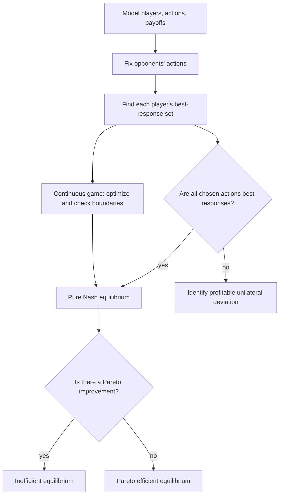

# Session 1: Strategic Games

Source: `game-theory/raw/GT Slides 01.pdf` (40 PDF pages, Beamer frames 1–31)  
Course: Game Theory (MGTHN0182)  
Lecture folder: `game-theory/`  
Session date on slides: 2026-10-05  
Processed: 2026-10-09  
Companion: [CONTEXT.md](CONTEXT.md)

## 80/20 Exam Summary

The central task is to model a strategic interaction and test whether every player is choosing a best response to the others. For a two-player payoff table, hold the column fixed and find Player 1's highest payoff in that column; hold the row fixed and find Player 2's highest payoff in that row. A cell marked as best for both is a pure Nash equilibrium. For continuous actions such as Cournot quantities, maximize each payoff conditional on the rival's quantity, respect boundaries, then solve the simultaneous best-response equations. Finally, assess welfare separately: a Nash equilibrium can be Pareto inefficient.

The deck marks the standard games, strategic-game definition, pure Nash equilibrium, Pareto efficiency, best responses, and best-response functions as “important.” That is a lecturer priority signal, not confirmation of exam format or question weights.

## Core Concepts and Notation

A **strategic game** is `⟨N, (A_i)_{i∈N}, (u_i)_{i∈N}⟩`. `N` is a finite set of players. Each nonempty `A_i` is Player `i`'s action set. `A = ∏_{i∈N} A_i` is the set of **action profiles**. Each `u_i: A → ℝ` assigns Player `i` a payoff to each profile. A game is **finite** if each action set is finite. In a payoff matrix, Player 1 chooses the row, Player 2 the column, and a cell lists `(Player 1 payoff, Player 2 payoff)`.

`a_i` is Player `i`'s action; `a_-i` is the profile of all other players' actions. The notation `(a_-i, a_i)` describes the complete profile with Player `i`'s action singled out. When evaluating a unilateral deviation, hold `a_-i` fixed.

A **pure Nash equilibrium** `a*` satisfies `u_i(a*_-i, a*_i) ≥ u_i(a*_-i, a_i)` for every player `i` and every feasible `a_i ∈ A_i`. No single player can gain by changing only their own action. This says nothing by itself about what happens when players coordinate a joint change.

A profile is **Pareto efficient** if there is no other feasible profile that makes someone strictly better off without making anyone worse off. This is a welfare test, not a solution rule for predicting play.

The **best-response correspondence** `B_i(a_-i) = {a_i ∈ A_i : u_i(a_-i,a_i) ≥ u_i(a_-i,a'_i) for all a'_i∈A_i}` returns every maximizing action. It may contain multiple actions. A **best-response function** `b_i` exists when that set has exactly one action for every opponents' profile. A pure Nash equilibrium is exactly a profile satisfying `a*_i ∈ B_i(a*_-i)` for all `i`, or `a* ∈ B(a*)` for the product correspondence `B(a) = ∏_i B_i(a_-i)`.

A **correspondence** maps an input to a subset of possible outputs: `f: X → P(Y)` or `f: X ⇒ Y`, where `P(Y)` is the power set of `Y`. This set-valued language is needed because ties can produce multiple best responses. On an open action set a maximum may not be attained, so a best-response set may even be empty: if `A_i=(0,1)` and `u_i(a_i)=a_i`, every feasible action can be improved.

## How to Solve a Payoff Table

1. State the players and their action sets; check which payoff belongs to whom.
2. For each **fixed column**, mark Player 1's largest first payoff among the rows.
3. For each **fixed row**, mark Player 2's largest second payoff among the columns.
4. Cells marked for both players are the pure Nash equilibria. If there are none, say “no pure Nash equilibrium”; mixed strategies are a later topic.
5. Check Pareto efficiency using comparisons across entire payoff pairs. Do not infer it from the Nash label.
6. Interpret the strategic tension: coordination, conflict, temptation to defect, or quantity competition.

### Battle of the Sexes

| Player 1 / Player 2 | Soccer | Ballet |
|---|---:|---:|
| Soccer | (2, 1) | (0, 0) |
| Ballet | (0, 0) | (1, 2) |

If Player 2 chooses Soccer, Player 1 prefers Soccer (`2 > 0`); if Player 2 chooses Ballet, Player 1 prefers Ballet (`1 > 0`). The same matching logic holds for Player 2. Thus `(Soccer, Soccer)` and `(Ballet, Ballet)` are both pure Nash equilibria. Both prefer attending together to choosing their favorite event alone, but they disagree on which coordinated outcome they prefer. The model alone does not select one equilibrium.

### Heilbronn–Munich Coordination

| Player 1 / Player 2 | Heilbronn | Munich |
|---|---:|---:|
| Heilbronn | (2, 2) | (0, 0) |
| Munich | (0, 0) | (1, 1) |

Both matched cells are pure Nash equilibria; `(Heilbronn, Heilbronn)` pays more to both. Yet `(Munich, Munich)` is stable against unilateral deviation. This is a coordination problem with one jointly preferred equilibrium. Do not confuse “payoff-dominant” with “the only equilibrium.”

### Prisoner's Dilemma

| Player 1 / Player 2 | Don't confess | Confess |
|---|---:|---:|
| Don't confess | (-1, -1) | (-4, 0) |
| Confess | (0, -4) | (-3, -3) |

For Player 1, Confess pays `0 > -1` when Player 2 does not confess and `-3 > -4` when Player 2 confesses. The same is true symmetrically for Player 2. Confess is a strictly dominant action for each, so `(Confess, Confess)` is the unique pure Nash equilibrium. `(Don't confess, Don't confess)` gives both `-1 > -3`; the equilibrium is Pareto inefficient. The source also adds 4 to each payoff, producing `(3,3), (0,4), (4,0), (1,1)`. A positive affine payoff change preserves the players' choices and equilibria here; absolute payoff numbers are not the strategic point.

### Hawk–Dove

| Player 1 / Player 2 | Dove | Hawk |
|---|---:|---:|
| Dove | (3, 3) | (1, 4) |
| Hawk | (4, 1) | (0, 0) |

Against Dove, Hawk yields `4 > 3`; against Hawk, Dove yields `1 > 0`. Both asymmetric profiles, `(Hawk, Dove)` and `(Dove, Hawk)`, are pure Nash equilibria. `(Dove, Dove)` is pleasant for both but unstable: either player gains by switching to Hawk. `(Hawk, Hawk)` is also unstable: either gains by switching to Dove. The conflict is over who bears the cost of being accommodating.

### Matching Pennies

| Player 1 / Player 2 | Head | Tail |
|---|---:|---:|
| Head | (1, 0) | (0, 1) |
| Tail | (0, 1) | (1, 0) |

Player 1 wants matching actions and Player 2 wants mismatching actions. At any cell, one player can improve by switching alone, so there is **no pure Nash equilibrium**. The deck's later “Mixed Equilibrium” topic is the natural next step; this session does not yet derive one.

## Cournot: Full Worked Derivation

**Decision problem.** Two firms choose nonnegative quantities `q_1, q_2` simultaneously. Each has unit cost `c`, with `0 < c < 1`. Market price is `p(Q)=max(0,1-Q)` for `Q=q_1+q_2`. Firm `i` earns `u_i(q_i,q_-i)=[p(Q)-c]q_i`.

**Method choice.** To find a Nash equilibrium, derive the quantity that maximizes each firm's profit for a fixed rival quantity. In the positive-price region, `Q≤1`,

```text
u_i = (1 - q_i - q_-i - c)q_i
    = (1 - c - q_-i)q_i - q_i².
∂u_i/∂q_i = 1 - c - q_-i - 2q_i.
∂²u_i/∂q_i² = -2 < 0.
```

Setting the first derivative to zero gives `q_i=(1-c-q_-i)/2`. Enforcing `q_i≥0` yields the unique best response

```text
b_i(q_-i) = max{0, (1 - c - q_-i)/2}.
```

If the rival supplies so much that this expression is nonpositive, producing zero is optimal. The `max(0,1-Q)` price floor does not make a large, loss-making quantity attractive: when price is zero, positive output incurs cost `cq_i`.

**Symmetric equilibrium.** In a symmetric equilibrium `q_1=q_2=q*`, and the interior branch applies because `0<c<1`:

```text
q* = (1 - c - q*)/2
3q* = 1 - c
q_1* = q_2* = (1-c)/3.
Q* = 2(1-c)/3.
p* = 1-Q* = (1+2c)/3.
u_i* = [p* - c]q* = (1-c)²/9.
```

**Symmetric Pareto benchmark on the slide.** With equal quantities `q_1=q_2=q`, total industry profit is `(1-2q-c)2q` in the positive-price region. Maximizing it gives total quantity `Q^P=(1-c)/2`, so each equal-output firm supplies `q_i^P=(1-c)/4`, earns `(1-c)²/8`, and has higher profit than at Nash equilibrium. This is the slide's **symmetric Pareto optimum**, not the Cournot Nash equilibrium. With the other firm at `q^P`, an individual firm's best response is `3(1-c)/8 > (1-c)/4`, so equal cooperative output is unstable against unilateral expansion.

**Numerical check with `c=0.4`.** Nash quantities are `q_1*=q_2*=0.2`; total quantity `0.4`; price `0.6`; each profit `(0.6-0.4)×0.2=0.04`. At the equal-output Pareto benchmark, each supplies `0.15`; total quantity `0.30`; price `0.70`; each profit `(0.70-0.40)×0.15=0.045`. The cooperative reduction raises each firm's profit, but each is tempted to expand quantity if the other stays at `0.15`.

**Managerial analogy.** Two producers can both benefit from lower total supply, but each wants to capture extra sales if the rival holds back. **Exam traps:** omitting the nonnegativity boundary; differentiating as if the rival's quantity also changes; confusing the jointly better symmetric quantity with Nash; assuming the price floor changes the interior result.

## Assumptions, Utility, and Solution Concepts

The lecture assumes rational players with complete and transitive preferences, utility representation, expected-utility maximization, and strong use of available knowledge. It names bounded rationality as a related idea, not the model used in Session 1. It lists Nash, subgame-perfect, and Bayesian Nash equilibria as solution concepts; only pure Nash is defined and used in this session. Ordinal utility preserves rankings under strictly increasing transformations. Expected-utility representation has the more restrictive positive-affine invariance. Do not treat those transformation claims as interchangeable.

A strategic-form description can represent a one-shot choice or an instance of repeated independent play. The payoff matrix alone does not supply a repeated-game history, punishment strategy, or discount factor.

## Visual Knowledge Map



## Subject Knowledge Graph

| Node | Meaning | Study use |
|---|---|---|
| Strategic game | Players, action sets, payoff functions | State the model |
| Action profile | One feasible action per player | Candidate outcome |
| Best-response correspondence | All maximizing actions against fixed opponents | Detect ties and missing maxima |
| Pure Nash equilibrium | Mutual best responses | Stability against unilateral change |
| Pareto efficiency | No feasible Pareto improvement | Welfare evaluation |
| Cournot competition | Simultaneous quantity choices | Continuous best-response derivation |

| From | Relationship | To | Why it matters |
|---|---|---|---|
| Payoff functions | determine | Best-response sets | Payoff comparison is conditional |
| Best-response sets | characterize | Pure Nash equilibrium | All players must be best-responding |
| Pure Nash equilibrium | can differ from | Pareto efficiency | Prisoner's Dilemma and Cournot show the distinction |
| Action constraints | constrain | Best-response function | Quantity cannot be negative |
| Matching Pennies | lacks | Pure Nash equilibrium | Pure analysis can return no cell |
| Cournot profit | yields | Quantity best response | Derivative plus boundary defines choice |

## Exam Relevance and Traps

**Confirmed from slides:** the lecturer marks the main definitions and standard games “important,” asks for best actions/equilibria, and asks “Why?” for Cournot equilibrium and the symmetric Pareto optimum. **Inferred practice targets:** being able to mark all pure equilibria, derive quantity best responses, explain failures of Pareto efficiency, and translate between notation and plain language. Assessment format and weighting are unconfirmed.

A strong answer states the model, shows conditional payoff comparisons or a derivative, lists **all** pure equilibria, verifies unilateral deviations, then gives a separate welfare interpretation. Do not call a player-specific preference a social ranking; do not conclude “no equilibrium” from “no pure equilibrium”; do not assume a best-response correspondence always has a unique element.

## Retrieval Prompts and Practice

Closed book:

1. Reconstruct the formal strategic-game triple and explain `a_i`, `a_-i`, and `A`.
2. State pure Nash equilibrium in words and symbols. Why is the deviation unilateral?
3. Explain why Pareto efficiency is a different question from Nash equilibrium.
4. Draw the Prisoner's Dilemma payoff table and prove the unique pure equilibrium.
5. Why does Matching Pennies have no pure equilibrium?
6. Derive Cournot's best response and symmetric equilibrium without looking at the slide.

Application:

1. For Battle of the Sexes, mark each player's best response in every row or column and list both equilibria. Explain why the model does not pick one.
2. For Hawk–Dove, test all four cells and identify the profitable deviation in each unstable cell.
3. In Cournot with `c=0.4`, reproduce the two quantities, price, and per-firm profit at Nash and at the equal-output Pareto benchmark. Explain the strategic incentive to deviate.
4. Construct a two-action game with a tie so a best-response correspondence contains two actions. Explain why a single-valued best-response function is then unavailable.

**Answer checks:** Battle of the Sexes has two matching pure equilibria; Hawk–Dove has two asymmetric pure equilibria; Matching Pennies has none in pure actions; Cournot gives `q_i*=(1-c)/3` and the equal-output Pareto benchmark `q_i^P=(1-c)/4`.

## Connections and Open Questions

This is the first Game Theory note. Future topics from the course outlook include fixed-point reasoning, mixed strategies, Bayesian and extensive-form games, repeated games, and bargaining; those have not yet been taught in the supplied material. If later slides introduce a different notation or refine assumptions, update this note and `CONTEXT.md` from the new source.

Open course questions: exam format and scope; whether proofs are assessed; whether a formula sheet or calculator is permitted. See [course logistics](../_course-logistics.md).

## Weakness Flags

No user recall session has happened yet. Record actual green/yellow/red results after the first session; do not infer mastery from note creation.
